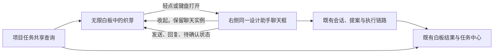

# 织芽接入无限白板

2026-11-08接入，2026-11-09更新导航与话语。现行实现取代此前“独立助手”和“仅供试玩”的接入描述；外观仍使用用户确认的毛绒样稿。验证结果分别见 [接入验证记录](validation.md) 和 [导航与话语验收](navigation-dialogue-validation.md)。

## 产品关系

织芽和现有设计助手聊天框是同一个助手的收起、展开形态。织芽只负责呈现和打开聊天，不创建会话，不发送需求，不确认生成，也不增加一套任务执行能力。

出现范围是无限白板的界面层。角色不跟随白板世界坐标缩放或平移，不写入画布文档、保存快照或导出图片。流程视图、其他业务页面不挂载角色。2026-11-09起移除顶部助手按钮；新版关闭、资源失败或白板加载失败时，在白板内显示普通助手按钮，继续打开同一聊天。

首次没有偏好时收起聊天；账号和项目共同决定后续偏好。`conversationId` 会话链接和“引用到助手”直接展开相应聊天。停靠栏默认 384 px，范围 320–480 px；宽度不足时沿用抽屉，手机沿用助手工作视图。开合、调宽保持白板中心和缩放。

聊天通过显隐切换持续挂载，草稿、光标、阅读锚点和进行中的回复继续保留。鼠标、键盘打开时恢复输入焦点；触屏打开由用户自行点输入框唤起软键盘。手机收起聊天再切回桌面保持关闭。

手机聊天提供“返回画布”。收起焦点恢复到画布内可用入口，不查找已移除的顶部按钮。目录、画布视图和聊天的开合分别管理，不替换编辑组件。

## 正式角色

组件位于 `apps/web/src/modules/assistant-character/`；发布资源位于 `apps/web/public/assistant/zhiya/assets/`。采用确认过的透明 WebP 分层、连续身体网格、绒面画板、缠布画笔、三个思考问号和克制的颜文字，不保留样稿按钮、尺寸切换器和演示聊天。

桌面角色画布宽 96 px，手机宽 72 px。400 ms 长按提起，长按前移动超过 6 px 取消点击；落点受白板可用界面范围约束，松手落定，Escape 恢复手势起点。边界预留底部工具条，气泡独立限位。透明区域通过轮廓命中检测穿透到白板。保存的是角色相对白板界面尺寸的位置，不是画布世界坐标。

本机键：

- 展开偏好与宽度：`fashion:workspace-split:<账号>:<项目>`，沿用现有分栏存储。
- 角色位置：`fashion:zhiya:<编码后的账号>:<编码后的项目>`。

`PlushCharacter` 负责渲染，`plush-runtime` 负责局部姿态和手势，`plush-body` 负责 WebGL 身体与原图降级，`ZhiyaAssistant` 只连接白板与项目状态。动画直接写角色自己的元素，不逐帧刷新 React、聊天或白板。

聊天展开、页面隐藏、失焦、角色不可见时停止绘制和唤醒计时；卸载清理监听、观察器及 GPU 对象。减弱动态使用稳定姿态。WebGL 不可用或上下文丢失时显示原毛绒图，恢复后重新建立身体网格；必要图片加载失败时撤下角色，保留普通聊天入口。

## 真实状态来源

白板最外层提供一个 `ProjectTaskProvider`，任务中心和织芽读取同一查询结果。查询键包含账号和项目，继续使用有运行任务时 3 秒、空闲时 15 秒的刷新节奏；后台暂停，恢复时读取。角色没有自己的网络请求或轮询。筛选、分页列表保持任务中心原有独立请求。

`GET /projects/:projectId/tasks?activity=1` 在旧响应上增加可选只读摘要；默认请求保持兼容。摘要直接聚合现有领域记录，不新增表、迁移、调度器或状态副本。权限、图片子任务去重和旧列表保持一致。完整协议见 [项目任务聚合](../../architecture/project-tasks.md)。

聊天只上报发送、回复、待确认和发送结果不确定等状态变化，不逐字驱动角色。

| 当前真实状态 | 呈现 |
| --- | --- |
| 没有运行任务和待处理事项 | 安静陪伴，间歇眨眼与轻微注意力反应 |
| 分析、回复、提交准备 | 思考，显示“思考中” |
| 仅有排队任务 | 思考，显示“排队中” |
| 实际执行 | 捧稿创作，保留画两笔、抬笔、停看的节奏 |
| 待补充、待确认、暂停待继续 | 疑惑等待，文字说明需要处理什么 |
| 新确认的成功结果 | 约 2.6 秒短反馈，随后恢复最新项目状态 |
| 新确认的失败 | 一次疑惑反馈，详情和操作仍在聊天、任务中心 |
| 明确取消 | 平静恢复，无完成庆祝 |

常态优先级为等待用户处理、实际执行、思考／排队、陪伴。历史失败仍可出现在任务中心的待处理列表，但不计入 `activity.awaitingUser`，不会让角色一直疑惑。休息姿态保留在动作库，首版不自动使用。

首次加载、切换账号／项目和重新打开页面建立基线。恢复显示后的第一份新摘要吸收隐藏期间的结果，不补播。按任务标识和明确结果去重，同批终态合并为一次反馈；同标识任务确实再次运行后，后续新终态可重新反馈。近期窗口回填的旧记录不会触发动作。

新活动、长按拖动可打断短反馈。动作结束读取最新常态，旧定时器不会把运行中的角色切回待机。列表消失、未知状态、请求失败和导出过期都不是成功或业务失败的证据；网络失败保留上次已知状态。

## 话语与目录（2026-11-09）

`CharacterPresentation` 分开描述动作、持续状态和可选 `CharacterSpeech` 事件。`character-dialogue.ts` 的本地文案库为每类事件准备3句，不调用模型。事件标识在真实转换时产生，同一状态的轮询与无关数量变化不会换句或重置时长。等待用户处理时，其他任务结果不覆盖当前提示。只有明确的设计/图片任务使用“创作”“这一版”等说法，领域不明确时使用“处理中”等通用表达。

开始类话语显示4秒，完成、失败及待处理显示6秒；悬停角色/气泡或键盘聚焦时暂停计时，离开后继续剩余时间。空闲无常驻文字，工作及等待时保留简短标签。气泡14px、实色底、轻描边、最多两行且不超过224px，默认位于上方，靠顶部自动翻到下方；位置变化不推动角色。180ms进入、120ms退出，减弱动态直接切换。角色和气泡都只打开原聊天；一次性话语通过独立的辅助技术通知读取。拖动、隐藏与卸载取消定时器，旧事件不能覆盖新状态。

退出动画开始后移入鼠标或键盘聚焦仍会暂停消失，恢复完整不透明度；离开后完成退出。新话语拥有新的事件与计时标识，旧退出回调不能清除当前话语。

旧接口不返回 `activity` 时，第一次有效任务列表仍建立话语状态基线，后续排队、执行和聊天变化可以正常触发短句。终态采用独立基线：接口开始提供活动摘要时先吸收历史成功/失败记录，只反馈随后新确认的结果。恢复显示后同样先吸收当前状态，不补播隐藏期间的话语。

创作类目录首次收起，资料类首次展开；`WorkspaceChrome` 统一状态，偏好键为 `fashion:workspace-navigation:<编码账号>:creation|document`，跨项目复用。桌面目录184px，收起后无占位；小屏使用左侧抽屉。图片/草图编辑暂时隐藏外层导航，退出恢复，不改变原偏好。项目菜单与任务入口分别位于画布左右上角，资料页并入当前页面操作行。

目录显示状态和稳定控制命令分别提供，白板及业务编辑器不因目录开合而整体刷新。嵌套账号菜单关闭时保持目录焦点边界，目录退出后恢复到展开按钮。

画布保存成功静默，保存中/待保存超过1秒显示；失败、冲突和断网仍有明确提示。离线提示属于工作区，不随目录收起。功能指引使用实际的展开按钮、画布助手入口和业务操作作为锚点；小屏重播时先收起目录。

## 启用、回退与维护

`NEXT_PUBLIC_ZHIYA_ENABLED` 为新版独立开关，默认启用，`.env.example` 中明确为 `true`。关闭时设置为 `false` 后重启开发服务或重新构建发布前端，普通聊天入口照常可用。旧 `NEXT_PUBLIC_FOREST_SPIRIT_ENABLED` 与旧模型清单不控制新版；白板已不再挂载旧 Live2D 加载入口。

共享协议发布时先构建 `@fashion/shared`，再更新 API 与 Web。旧 API 没有 `activity` 时前端兼容读取活动列表，但不猜测终态。新增摘要没有数据库迁移。本轮没有调用收费模型、提交、推送或部署生产。

旧模型、拆层、审计与样稿作为历史资料保留。新版资源来源是确认过的毛绒图和同源道具，没有使用 DS 鲸鱼娘的模型、纹理或动作文件。

后续修改动效时，以已确认外观和节奏为基线，复跑真实计时的性能脚本；不可用动画函数的执行耗时、模拟时钟或录屏文件帧率替代实际帧间隔。
