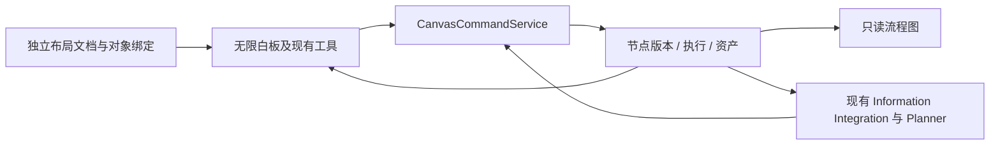

# 无限白板工作区迁移

实施阶段：2026-11-05，开发线 `canvas-workspace`。本阶段保留现有页面、视觉体系、助手、工具面板、任务与业务服务，只替换项目的主要创作交互。

后续的交互、保存恢复及只读隔离修复见 [白板复核与界面完善](REFINEMENTS.md)。按用户新约定，CI 仅在明确要求时进行；日常修改采用相关本地定向验证。

## 数据与交互边界

- `CanvasDocument` 保存 tldraw 快照、格式与布局版本；`CanvasObjectBinding` 将摆放实例绑定到节点，删除实例保留墓碑；`CanvasMutation` 保存操作编号、请求指纹和回执。
- 素材、约束、版本、执行和决定仍由 `WorkflowGraph`、`WorkflowNodeVersion`、`WorkflowExecution`、`WorkflowAttempt`、`DesignAsset` 保存。布局更新不调用语义图修改、不改变已执行输入。
- 画框、分组、坐标、缩放和普通箭头仅用于整理。容器选择递归展开成员，引用去重，空选择保留草稿；超过 16 项明确提示，不截断、不发送模型请求。
- 原始手绘保存在白板文档；明确引用时先导出图片、等待上传完成、保存笔画版本并建立节点。后续可通过原草图编辑器在固化底图上编辑，原生笔画仍保存在白板中。
- 多个摆放实例可以引用同一素材。被执行使用的素材内容变更派生新节点，旧执行和输入版本保持不变。撤销布局不撤销计费或执行。
- 工作台使用原自由白板的 shape utilities 和 tldraw 交互；外层导航、助手收起/调宽/窄屏浮层和其他业务页面继续复用。

## 业务入口与助手

新增 `GET/PATCH /projects/:id/canvas`、`POST /canvas/initialize`、`POST /canvas/commands`、`PATCH /canvas/mode`。所有接口复用项目权限；归档项目不可写。模式切换要求管理权限，独立于 Agent 版本。

业务命令只接收素材创建/编辑、工具运行/配置、已有工具执行、决定、版本恢复和系列关联，不接收任意图编辑。图构造、端口校验、版本、事务与队列沿用现有服务。新模式的公共工作流 PATCH、提案创建和接纳入口拒绝手工图修改；内部服务仍可通过已校验的业务操作记录真实步骤。

趋势、色卡、面料、品牌、衣架和试穿等现有入口改用素材命令。一次导入的多个素材与摆放绑定在同一事务内保存，失败整体回滚；网络重试保留整个批次的操作编号。图片工具在发送前持久化原始命令，刷新后提示恢复原操作，不自动重新执行。

Planner 增加结构化 `execution` 意图，且必须引用完整的本轮指令。后端另外排除讨论、否定、假设、未澄清输入和后台观察。明确请求在校验后直接执行；需要需求分析时只允许固定的一次分析到生成衔接，不进行自主循环。参数仍由统一工具目录解析。

用户消息记录发送时的引用版本；执行前再次检查引用版本和会话意图，入队后使用不可变快照。直接执行持久化筹备状态与租约；恢复、SSE 重连和同一请求重放使用固定操作编号。停止助手只阻止未提交的后续筹备，生图取消仍由任务中心负责。

## 初始化与恢复

迁移 `20261105090000_canvas_workspace` 只新增表和项目字段，不修改已应用迁移。首次由可编辑成员进入时自动初始化：节点项目投影当前素材与结果；只有旧白板的项目复制布局并导入可识别素材；混合项目以当前节点为准，旧白板从原历史入口查看和逐项导入。没有来源的旧素材标记历史导入，不补造关系。

初始化由项目级事务锁保护。布局使用独立 CAS 版本，业务操作使用原图版本；冲突保留 IndexedDB 草稿，界面允许导出本机草稿后载入服务器版本。未完成的保存可以使用原操作编号重试。

回退使用 `PATCH /projects/:id/canvas/mode`，请求体 `{"mode":"node"}`；重新启用使用 `{"mode":"canvas"}`。回退保留新文档、绑定、资产及全部历史，不做数据库降级删除。

## Git 阶段与升级

保留 `free-interaction`、`node-interaction`、`canvas-workspace` 三条阶段分支；新阶段从实际节点尖端 `d4a5b2ce6a9b07a4530ca2c267c29f362a714caf` 创建。原计划的 `287d14e` 之后已有节点阶段改进，已一并保留。

- `baseline/node-interaction-20261105` 保存迁移前节点基线，原两枚 baseline 标签不变。
- `archive/main-20261105` 保存远端 main 的 `0b408acb6dba722d6fb4c0bf0e28a4a1d0f1af34`。
- `archive/main-local-20261105` 单独保存本地 main 的 `41aa26e16a5296e22084a8d9db446b4262609746`；两条历史分歧，不能只归档其中一个。
- `archive/project-upload-20260930` 保存旧上传分支尖端 `3779b80dfefd50c3a6162bbaeb6af3ace37feef5`。
- 已确认归档标签推送成功、分支无保护/规则集/未合并 PR 后，删除旧 main 和旧上传分支引用；不改写提交历史。

升级运行 `pnpm install --frozen-lockfile`、`pnpm db:deploy`、`pnpm build`，随后重启 API、Web 与 Worker。保持现有环境变量与模型默认值。新阶段不整体合并回历史阶段分支。

验证证据见 [验收记录](ACCEPTANCE.md)。模拟 Provider、真实基础设施和外部模型分别记录。
