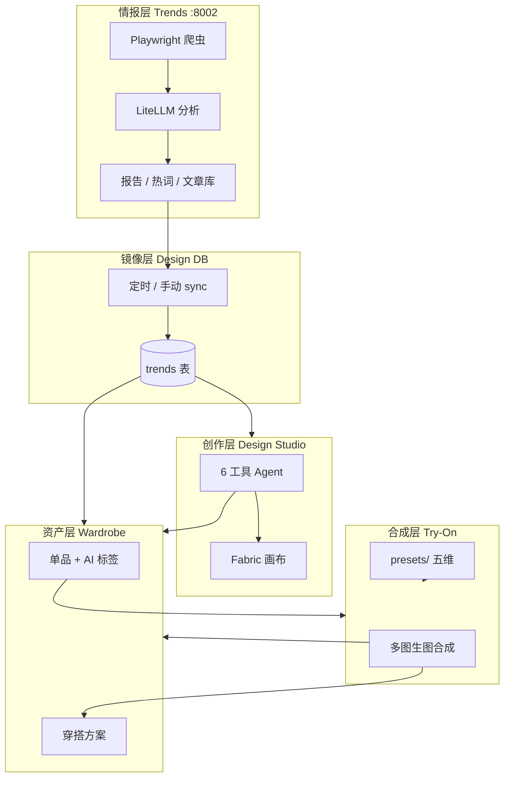

# AI 时尚设计平台 — 系统功能与可能性报告

> 基于代码库调研（2026-06）  
> 项目路径：`fashion-design/`  
> 报告侧重：**系统能做什么、能组合出什么、如何扩展**

---

## 一、平台定位：从「工具集合」到「时尚创作操作系统」

本平台不是单一功能的网页应用，而是一套**可并行打开、状态隔离、数据互通**的时尚 AI 工作环境。用户在同一浏览器会话中，可以同时拥有：

- 一个正在对话生图的设计工作台  
- 一个正在拼装穿搭的试衣台  
- 一个正在整理单品的数字衣橱  
- 一个正在浏览报告与热词的趋势中心  

四大模块共享**同一用户身份与个性化档案**，但各自维护独立 UI 状态（Tab 切换不卸载、ErrorBoundary 隔离崩溃）。这种架构使平台天然具备**多任务并行**与**跨模块流水线**能力——趋势发现 → 设计探索 → 虚拟试衣 → 资产沉淀，可以在一次会话内闭环完成。

**启动方式**

```bash
python start.py   # 前端 3100 + 设计服务 8001 + 趋势服务 8002
```

| 服务 | 端口 | 职责 |
|------|------|------|
| React 统一壳 | 3100 | 四大工作区、认证、代理 |
| Design Studio | 8001 | 生图、对话、衣橱、试衣、趋势镜像库 |
| Trend Analysis | 8002 | 爬虫、LLM 分析、报告、WebSocket 流水线 |

---

## 二、架构可能性：为什么这个系统「可生长」

### 2.1 模块化工作区（Plugin-like Tabs）

主壳 `MainApp.tsx` 将产品抽象为四种 `WorkspaceType`：

| 序号 | 类型 | 中文名 | 设计代号 |
|------|------|--------|----------|
| 01 | `design-studio` | 画布工作台 | L'Atelier |
| 02 | `tryon` | 试衣台 | La Pose |
| 03 | `wardrobe` | 我的衣橱 | La Garde-Robe |
| 04 | `trends-hub` | 时尚趋势 | L'Air du Temps |

每种工作区可以**多次实例化**（新建 Tab），例如同时开两个设计项目 Tab，或一个趋势探索 + 一个趋势分析。已访问过的 Tab 通过 `mounted` Set 保持挂载，切换仅隐藏可见性——这对 iframe 型趋势分析（避免重载）和复杂画布状态尤其重要。

**扩展含义**：新增第五模块（如「订货会看板」「面料库」）只需增加 `WorkspaceType`、PRESETS 元数据和一个 lazy 组件，无需重写导航壳。

### 2.2 双后端 + 统一 API 代理

前端通过 Vite 代理将路径映射到不同进程：

| 浏览器路径 | 目标 | 典型用途 |
|------------|------|----------|
| `/api/design/*` | :8001 `/api/*` | 设计、衣橱、试衣、认证 |
| `/api/trend/*` | :8002 `/api/*` | 报告、流水线、热词 |
| `/api/images/*` | :8001 | 用户生成图、衣橱图 |
| `/api/tryon/*` | :8001 | 试衣预设图、试衣输出 |
| `/ws/*` | :8002 | 流水线实时进度 |

**扩展含义**：趋势分析与设计生产解耦——爬虫与 LLM 报告可以 24h 跑批，设计侧按需 sync；未来可独立扩容 GPU 生图集群而不动趋势服务。

### 2.3 数据层：SQLite 用户域 + 文件域

设计服务 `services/design/data/profiles.db` 持久化：

- 用户与认证  
- 个人/设计师个性化档案  
- 趋势镜像（从报告 sync）  
- 衣橱单品、穿搭方案  
- 遗留 Library 素材（API 仍可用）

图像落在 `services/design/outputs/`（按用户 hash 分目录），预设资源在 `services/design/presets/`（manifest + 静态图）。

**扩展含义**：单机即可演示完整链路；迁移到对象存储 + Postgres 时，边界清晰（DB 存元数据，outputs 存 blob）。

### 2.4 AI 提供方可插拔

| 子系统 | 当前实现 | 配置入口 |
|--------|----------|----------|
| 设计/试衣/衣橱视觉 | **amux.ai** OpenAI 兼容 API | `AMUX_API_KEY`, `AMUX_TEXT_MODEL`, `AMUX_IMAGE_MODEL` |
| 趋势分析 | **LiteLLM**（DeepSeek 等） | `services/trend/.env` |

设计侧统一经 `services/design/ai_clients.py`：`generate_image()` 同时承担文生图、多图编辑、试穿；Agent 对话走 `chat_with_tools()`。趋势侧独立 `llm_analyzer.py`，支持多模态与 OCR 回退。

**扩展含义**：换模型多为环境变量级变更；业务 API 与前端契约不变。

---

## 三、四大模块功能多样性详解

### 3.1 画布工作台（Design Studio）— 创作与 Agent 编排

**核心价值**：自然语言驱动的**多工具 AI Agent**，配合专业画布，覆盖从灵感到可编辑成稿的全链路。

#### 3.1.1 六种 AI 工具（可组合、可多轮）

Agent 在对话中自主调度以下工具（`server.py` TOOL_EXECUTORS）：

| 工具 | 能力 | 典型场景 |
|------|------|----------|
| `tool_text_to_image` | 文生图 | 从零描述生成款式 |
| `tool_draw_sketch` | 线稿/草图 | 结构探索、工艺示意 |
| `tool_edit_image` | 语义改图 | 改色、改细节、保留风格 |
| `tool_transfer_pattern` | 图案迁移 | 将纹样应用到目标服装 |
| `tool_generate_model` | 生成展示模特 | 为试穿准备人体基准 |
| `tool_try_on` | 对话内虚拟试穿 | 服装图 + 模特图合成 |

工具可**并行**（`_can_run_parallel`）或在多轮中串联——例如先草图 → 再上色 → 再生成模特 → 再试穿，全程保留会话上下文与生成历史。

#### 3.1.2 画布与像素编辑

- **DesignCanvas**（Fabric.js）：图层、缩放、拖放本地/生成图、空态引导  
- **FabricEditor**：画笔蒙版 + `POST /api/design/edit_with_mask` 局部 AI 修改  
- 画布与对话双向：选中图发送到 AI、历史图一键置入画布、预览与下载  

#### 3.1.3 双模式个性化

| 模式 | 对象 | 能力 |
|------|------|------|
| **Personal** | 个人穿搭用户 | 体型、风格关键词、场合、预算；动态 inferred 标签 |
| **Designer** | 设计师 | 多项目、brief、设计语言、项目级趋势锚定 |

对话请求自动注入 `_build_personalization_context()`；流式结束后异步更新用户信号并触发再分析（`sessions_analyzed` 阈值）。待确认标签经 **ProfileDiffModal** 人工确认后写入档案——**人机协同**而非黑盒画像。

#### 3.1.4 趋势上下文注入

- 从 Trends Hub「用这个设计」开 Tab → `createConversationSessionWithTrend(trend_id)`  
- 聊天侧栏 **TrendHotInline** 拉取 `/api/trend/trends/hot` 热词辅助 compose  
- 设计师项目可 **锚定多条趋势**（`addTrendToProject`），项目对话注入 `_build_project_trend_context`  

#### 3.1.5 会话资产

- 上传批量（最多 12 张）、`@` 引用会话内历史图  
- `enhance-prompt` 提示词增强  
- 收藏、统计、导出  
- 生成图 **「收入衣橱」** → 打通资产沉淀  

**可能性小结**：Design Studio 既是「ChatGPT for fashion images」，也是「带 AI 的 Figma -lite」——适合款式开发、客户提案、快速 Mood Board。

---

### 3.2 试衣台（Try-On）— 五维预设 × 生图合成

**核心价值**：不依赖传统 3D 物理引擎，以**多图参考 + 结构化 Prompt** 实现「看得见的选择、点得动的试穿」——降低虚拟试衣技术门槛，同时保留高度可配置性。

#### 3.2.1 五维选择空间

| 维度 | 选择模式 | 数据来源 | 传给模型方式 |
|------|----------|----------|--------------|
| **穿搭** | 多选 | 衣橱 + 系统预设 | 图像参考（多件）+ 超出部分转文字 |
| **模特** | 单选 | `presets/models` | 必传图像；未选则用默认 |
| **背景** | 单选 | `presets/backgrounds` | Prompt 描述 |
| **动作** | 单选 | `presets/actions` | Prompt 描述 |
| **美颜** | 发型 + 发色各一 | `presets/beauty` | Prompt 描述 |

用户可叠加 **extra_prompt**（自定义描述），并在 UI 预览自动拼合后的完整提示词——**透明可控**的生图，而非黑盒一键。

#### 3.2.2 生成调度

- 手动点击「生成」（节省 API 成本）  
- 同用户并发锁 + 429，防双击  
- `AbortController` 可取消  
- 输入图自动压缩至 1024 长边，加速上传  
- 历史条保留最近 3 张，可切换对比  

#### 3.2.3 结果处置

| 操作 | 效果 |
|------|------|
| 保存穿搭 | 系统预设衣物自动入库 → 创建 Outfit，封面为生成图 |
| 收入衣橱 | 整图作为「我的设计」来源入库 |
| 重新生成 | 相同 selection 再次调用（不同随机性） |
| 下载 | 本地保存 PNG |

**可能性小结**：试衣台适合**电商 Lookbook 预览**、**买手搭配提案**、**KOL 内容预演**；建造者只需维护 `presets/` 目录即可更换整套视觉资产（无需改代码）。

#### 3.2.4 建造者扩展点（`services/design/presets/`）

```
presets/
├── clothes/      manifest.json + *.png   （8 大衣橱分类）
├── models/       gender: male|female
├── backgrounds/
├── actions/
└── beauty/       type: hairstyle|color
```

服务启动时自动创建空 manifest；静态图挂载于 `/api/tryon/preset-images/`。README 含完整字段说明与 JSON 示例。

---

### 3.3 我的衣橱（Wardrobe）— 数字资产中枢

**核心价值**：把分散在各模块的「衣服图」统一为**可检索、可分类、可组合**的结构化资产库。

#### 3.3.1 九大分类维度

`all` · `top` · `bottom` · `suit` · `shoes` · `bag` · `jewelry` · `accessory` · `uncategorized`

#### 3.3.2 四种来源（跨模块汇入）

| source_type | 标签 | 入口 |
|-------------|------|------|
| `trend` | 时尚趋势 | 趋势看板「收入衣橱」 |
| `design` | 我的设计 | 设计对话 / 试衣台生成图 |
| `upload` | 我的上传 | 本地上传 |
| `preset` | 系统衣物 | 试衣台保存穿搭时自动 ingest |

#### 3.3.3 AI 自动打标

入库后异步 `vision_analyze`：名称、分类、颜色、风格标签、季节、面料等；支持 **re-analyze** 重跑。用户可在抽屉中 PATCH 修正——**AI 初标 + 人工精修**。

#### 3.3.4 穿搭方案（Outfits）

- 多选单品 → 命名创建  
- 试衣台保存时自动关联全部参与衣物 + 生成图封面  
- 独立 Tab 浏览、删除  

**可能性小结**：衣橱是平台的**数据飞轮中心**——用得越多，试衣可选资产越多，趋势与设计产出越有沉淀价值。

---

### 3.4 时尚趋势（Trends Hub）— 情报 + 分析双引擎

**核心价值**：一端连接**外部时尚情报**（爬虫 + LLM），一端连接**内部创作**（看板 + 设计上下文）。

#### 3.4.1 子页签 A：趋势探索（React）

| 功能 | 说明 |
|------|------|
| 为你推荐 / 全部 | 基于个人 `style_keywords` 的 match_score |
| 季节筛选 | sync 自报告的季节桶 |
| 搜索 | 名称、关键词 |
| 收藏 | 用户级 favorite |
| 详情抽屉 | 色盘、设计语言、图库 |
| **用这个设计** | 跳转 Design Studio 并注入 trend session |
| **收入衣橱** | 趋势封面图入库 |
| **加入设计项目** | 设计师模式锚定趋势 |

设计库中的趋势由 **每小时自动 sync**（`GET trend:8002/api/reports/latest` → SQLite `trends`）或手动 `POST /api/trends/sync` 更新。

#### 3.4.2 子页签 B：趋势分析（iframe + 独立 SPA）

嵌入 `services/trend/frontend/`，对接完整流水线 UI：

| 页面 | 能力 |
|------|------|
| Dashboard | 统计、最新报告摘要、热词 |
| Reports | 列表、详情、对比、导出 |
| Seasons | 季节趋势视图 |
| Articles | 爬取文章库 + 全文搜索 |
| Keywords | 维度统计、时间线 |
| Pipeline | WebSocket 实时阶段进度 |

#### 3.4.3 趋势流水线（后端）

```
Playwright 爬虫 → processor 质量打分 → LLM 并行分析 → SQLite/JSON/Markdown 持久化
```

- 多站点：`services/trend/site_configs/*.yaml`（如 Vogue CN）  
- 登录态：`storage_state` 持久化 cookie  
- 调度：APScheduler 24h 或 API 手动 trigger  
- LiteLLM：OpenAI / Anthropic / DeepSeek / 本地 Ollama  interchangeable  

**可能性小结**：趋势模块既可作**买手研究工具**，也可作**设计 Agent 的外部记忆**——报告结构化字段直接驱动对话 prompt 与衣橱入库。

---

## 四、跨模块组合：系统「可能性矩阵」

以下不是未来规划，而是**当前代码已支持**的用户旅程：

| 旅程 | 步骤 | 价值 |
|------|------|------|
| **趋势驱动设计** | 报告 → 探索看板 → 「用这个设计」→ Agent 生图 | 从情报到稿图分钟级 |
| **趋势资产化** | 看板详情 → 收入衣橱 → 试衣台选用 | 流行元素进入私有库 |
| **设计资产化** | 对话生图 → 收入衣橱 / 置入画布编辑 | 生成物可复用、可组合 |
| **衣橱驱动试衣** | 上传/入库 → 试衣台多选 → 五维 preset 增强 → 保存穿搭 | 真实库存 + 虚拟场景 |
| **设计师项目线** | 新建项目 → 锚定趋势 → 项目模式对话 → 输出系列感 | B2B 款式开发 |
| **个人穿搭线** | Onboarding 档案 → 推荐趋势 → 试穿验证 → Outfit 存档 | C 端搭配助手 |
| **情报运维线** | 趋势分析 trigger → WS 看进度 → 报告 export → sync 到设计库 | 运营/研究闭环 |



---

## 五、功能多样性总览表

| 类别 | 功能点数量级 | 代表能力 |
|------|--------------|----------|
| AI 生图/编辑 | 6+ 工具 | 文生图、草图、改图、图案、模特、试穿 |
| 画布交互 | 10+ | 图层、拖放、蒙版编辑、缩放、历史 |
| 试衣维度 | 5 模块 | 衣/模/景/动/美颜 + 自定义 prompt |
| 衣橱 taxonomy | 9 分类 × 4 来源 | 检索、上传、AI 标签、Outfit |
| 趋势 UI | 2 子系统 × 6+ 页面 | 推荐、报告、季节、文章、热词、流水线 |
| 个性化 | 2 模式 × 动静态档案 | Personal / Designer 项目 |
| HTTP API | 80+ 路由 | 设计、衣橱、试衣、趋势、认证、Library |
| 扩展目录 | 2 套 | `presets/`、`site_configs/` |

---

## 六、遗留能力与隐藏潜力

### 6.1 Library（我的库）— API 完整、UI 未挂载

`LibraryWorkspace.tsx` 仍实现：收藏、智能合集、suggest-outfit、相似图、批量 analyze。`MainApp` 已用 **Wardrobe** 取代入口，但 `/api/library/*` 与设计个性化信号仍联动。

**可能性**：可作为「生成图版本链」或「设计师素材墙」重新接入，与 Wardrobe 差异化（Library 偏 session 产出，Wardrobe 偏穿戴单品）。

### 6.2 Stub 服务

`services/_stubs/` 在无 API Key 或依赖缺失时提供健康检查占位，便于 UI 开发与演示。

### 6.3 一键启动与 Windows 脚本

`start.py`、`scripts/start-all.bat/sh` 支持非技术用户本地演示完整三进程环境。

---

## 七、面向不同角色的「可能性解读」

### 7.1 独立设计师 / 小型工作室

- 用 **Trends** 抓季节方向 → **Design Studio** 快速出款图 → **Try-On** 看上身效果 → **Wardrobe** 归档 Season 系列  
- **Designer 项目** 隔离不同客户 brief  

### 7.2 电商 / 品牌内容团队

- 维护 `presets/models` + `presets/backgrounds` 统一品牌模特与场景  
- 试衣台批量产出 Lookbook 风图（衣橱 + 预设衣）  
- 趋势 sync 保证选品与站内「趋势探索」一致  

### 7.3 趋势研究 / 买手

- **Trend Analysis** 全流水线 + 报告 export  
- 文章库检索 + 热词时间线  
- 无需进入设计模块即可独立使用 :8002  

### 7.4 平台建造者 / 二次开发

| 改造目标 | 改动面 |
|----------|--------|
| 换生图模型 | `.env` 中 `AMUX_*` 或 `ai_clients.py` |
| 加试衣预设 | 仅 `presets/**` + 图片 |
| 加爬虫源 | `site_configs/` 新 YAML + 可选 login CLI |
| 加第五工作区 | `MainApp` + 新 module 目录 |
| 企业 SSO | 扩展 `/api/auth/*` 与 `App.tsx` guard |

---

## 八、技术栈与质量属性

| 层 | 技术 |
|----|------|
| 前端 | React 19、Vite、Tailwind、Fabric.js、lazy + Suspense |
| 设计后端 | FastAPI、SQLite、Pillow、OpenAI SDK → amux |
| 趋势后端 | FastAPI、Playwright、LiteLLM、APScheduler、WebSocket |
| 持久化 | SQLite + 本地 outputs + JSON 报告 |

| 属性 | 实现 |
|------|------|
| 模块隔离 | ErrorBoundary、独立 Tab state、双后端进程 |
| 开发体验 | Vite 代理、Stub 降级、manifest 热加载（改 preset 即生效） |
| 并发控制 | 试衣 per-user lock、Agent rate limit |
| 状态恢复 | 试衣 selection/history → sessionStorage |

---

## 九、总结：系统的「多样性」来自三层叠加

1. **垂直深度**：每个模块内部功能完整（Agent 六工具、试衣五维、衣橱全链路、趋势流水线六页面）。  
2. **水平广度**：四大模块并列，同一用户会话内可任意组合 Tab。  
3. **纵向集成**：趋势 → 设计 → 试衣 → 衣橱 的数据与动作已打通，而非四个孤立 App。

因此，本平台的价值不仅在于「能 AI 生图」或「能爬 Vogue」，而在于**把时尚行业分散在 research / design / styling / asset 四个环节的工具，压缩进一个可扩展的操作系统壳**——建造者通过 preset 与 site config 换血，开发者通过 API 与 Workspace 扩展新能力，业务用户通过跨模块点击完成从趋势到成图到入库的闭环。

---

## 附录 A：主要 API 前缀速查

| 前缀 | 服务 | 示例 |
|------|------|------|
| `/api/design/chat` | 8001 | 流式 Agent 对话 |
| `/api/design/wardrobe/*` | 8001 | 衣橱 CRUD、Outfits |
| `/api/design/tryon/*` | 8001 | presets、generate、save-outfit |
| `/api/design/trends/*` | 8001 | 看板、收藏、sync |
| `/api/design/profile/*` | 8001 | 个性化档案 |
| `/api/trend/reports/*` | 8002 | 报告 |
| `/api/trend/pipeline/*` | 8002 | 流水线控制 |
| `/ws/pipeline` | 8002 | 进度推送 |

## 附录 B：关键源码索引

| 模块 | 路径 |
|------|------|
| 主壳 | `frontend/src/pages/MainApp.tsx` |
| 设计工作台 | `frontend/src/modules/design-studio/` |
| 试衣台 | `frontend/src/modules/tryon/` |
| 衣橱 | `frontend/src/modules/wardrobe/` |
| 趋势 Hub | `frontend/src/modules/trends-hub/` |
| API 客户端 | `frontend/src/api/profileApi.ts` |
| 设计后端 | `services/design/server.py` |
| AI 适配 | `services/design/ai_clients.py` |
| 试衣预设 | `services/design/presets/` |
| 趋势后端 | `services/trend/api.py` |
| 站点配置 | `services/trend/site_configs/` |

---

*文档由代码库静态分析生成；模型与端口以 `env.example` 及 `ai_clients.py` 为准。*
